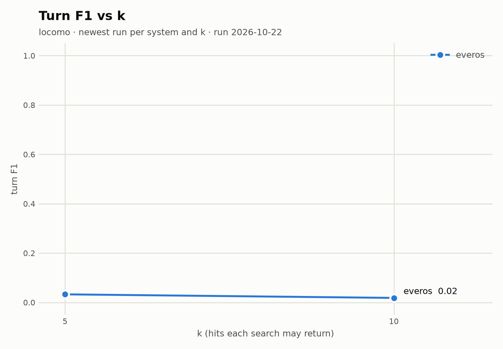
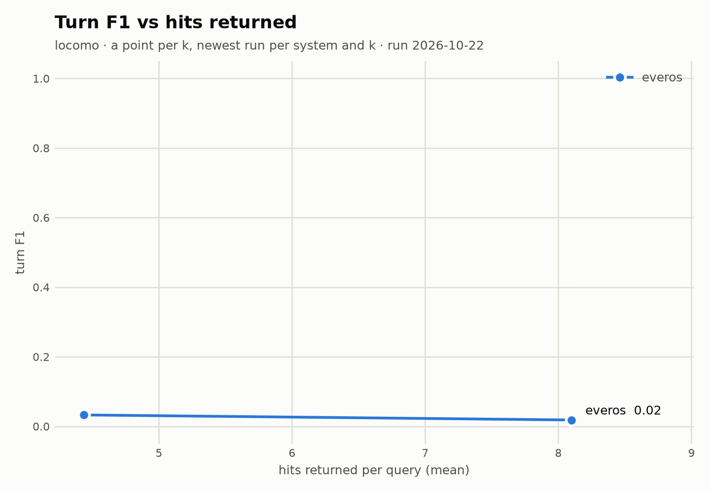
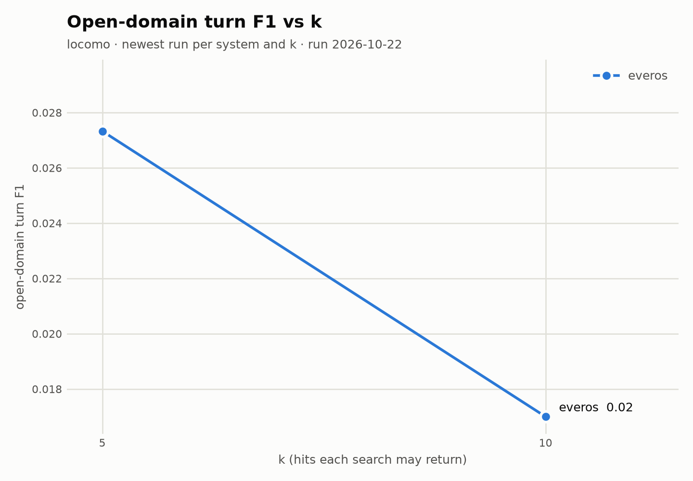
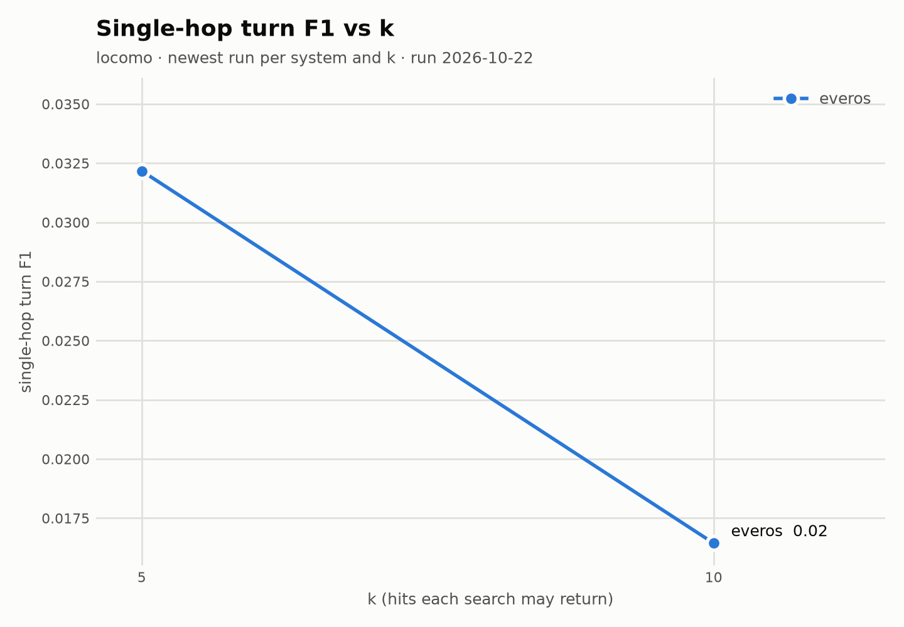
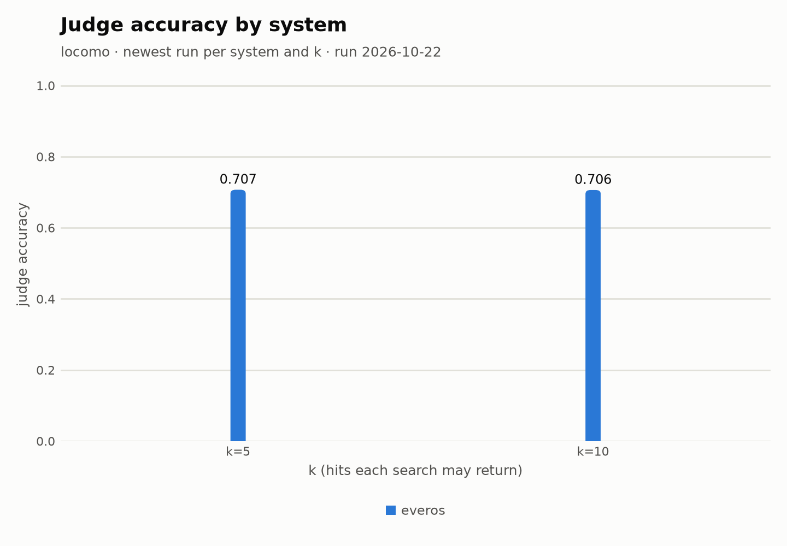
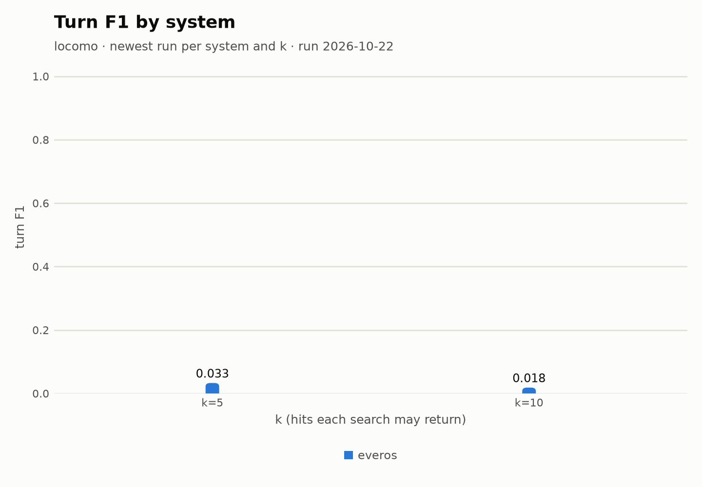
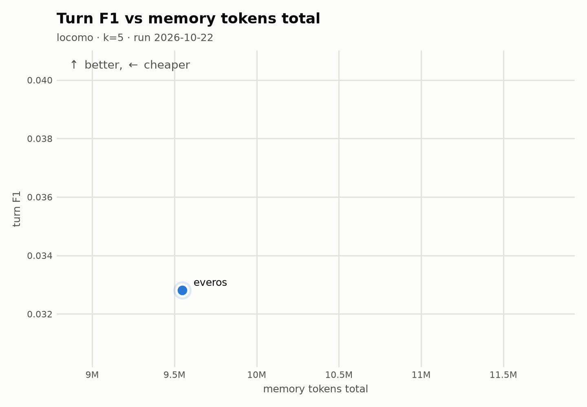
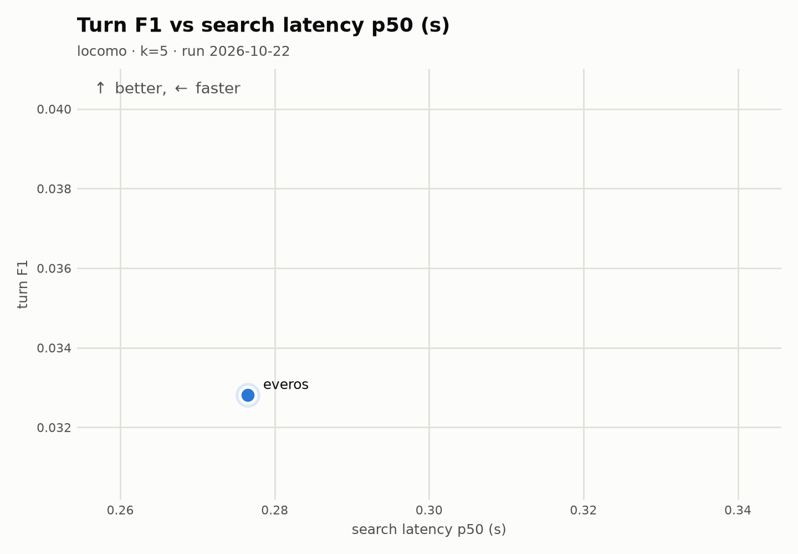
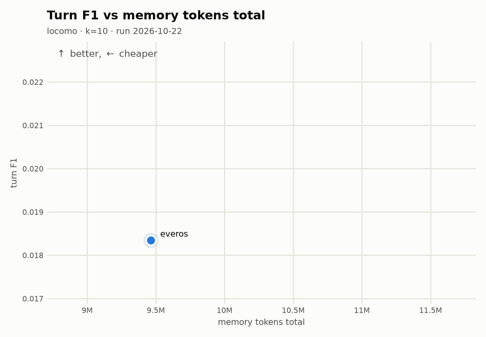
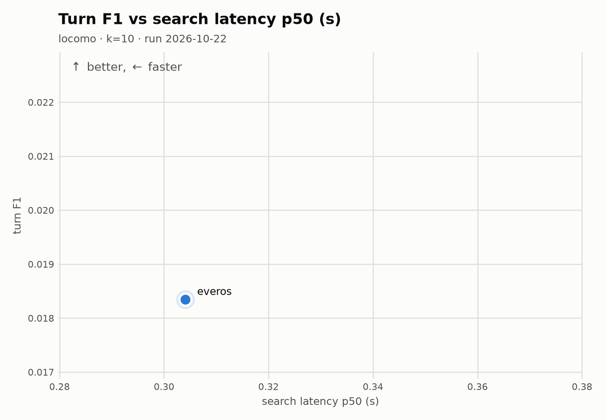

# Agent Memory Benchmark — Results

Generated by `amb report` from the runs saved under [`runs/`](runs/) — every table, chart, and line of this file. Edits here are overwritten on the next run; change the report definition in `src/amb/reporting/report.py` instead.

Results from `everos/v0.5.0` (commit `fb77ee5`), run 2026-10-22.

## Every run

Latest run per system x dataset x models. Each row's full per-question output lives in `runs/<dataset>/<system>/<run-id>/` — or with an extra `<variant>` level (`runs/<dataset>/<variant>/<system>/<run-id>/`) for a dataset run with `--variant`, e.g. LongMemEval's oracle/s/m, since those are different experiments sharing one dataset name, not different runs of the same one.

| dataset | variant | system | system_version | k | ingestion_model | embedding_model | system_params | model | judge_model | max_turns | sample_seed | workers | num_questions | answer_f1 | exact_match | hits_per_query | judge_accuracy | memory_lift | memory_tokens_total | turn_f1 | turn_precision | turn_recall | turns_per_query | search_p50_s | search_p95_s |
| --- | --- | --- | --- | --- | --- | --- | --- | --- | --- | --- | --- | --- | --- | --- | --- | --- | --- | --- | --- | --- | --- | --- | --- | --- | --- |
| locomo |  | everos | 1.4.2 | 10 | anthropic:claude-haiku-5-5 | openai:text-embedding-3-small |  | anthropic:claude-haiku-5-5 | anthropic:claude-haiku-5-5 |  |  | 3 | 1986 | 0.477 | 0.240 | 8.100 | 0.706 | 0.459 | 9463686.000 | 0.018 | 0.009 | 0.932 | 147.350 | 0.3041 | 0.9997 |
| locomo |  | everos | 1.4.2 | 5 | anthropic:claude-haiku-5-5 | openai:text-embedding-3-small |  | anthropic:claude-haiku-5-5 | anthropic:claude-haiku-5-5 |  |  | 3 | 1986 | 0.481 | 0.246 | 4.437 | 0.707 | 0.440 | 9547505.000 | 0.033 | 0.017 | 0.891 | 80.550 | 0.2765 | 0.9737 |

## Plots

Every question is a binary verdict — the judge marks the agent's answer correct or not — so the headline is judge accuracy, beside turn F1, which scores what the agent retrieved against the evidence turns. Written by `amb plot all` into `plots/<dataset>/`, one directory per dataset (or `plots/<dataset>/<variant>/` for a dataset whose variants are separate experiments). Each section opens with its sweeps over k — the same overview the [README](README.md#results) shows — followed by the detail per k.

### locomo

#### locomo: scores vs k

One line per system across the k sweep, newest run per system and k.

#### locomo: scores vs hits returned

The same sweep, placed at the hits each k actually returned: k is the budget granted, hits per query what a system spent of it. Compare systems at a matched spend, where returning fewer hits than allowed cannot pass for ranking better.

#### locomo: turn F1 vs k by question category

The breakdown table at one k, swept: whether a system is weak on a question type, or simply needed a bigger budget.

#### locomo: system comparison

A block of columns per k, one per system, newest run; each block's best value is printed on its column.

---

#### locomo: by question category (k=5)

Where each system finds the evidence, not just how often overall. The best turn F1 in each column is bold.

#### locomo: error analysis (k=5)

Who lost each question: the memory, or the agent it served. Each judged question with evidence labels is split by whether every evidence turn was retrieved, then by the judge's verdict. The two tables mirror each other: the verdict columns are shares of the branch, the branch's own rate over every question closes the row, and both keep one row order, most found first. Questions without evidence labels (LoCoMo's adversarial ones) are left out, not scored as misses.

**Found.** The memory did its job. `correct with evidence` is the agent's own rate and should be flat across systems; where it is not, a memory is handing back evidence in a form the agent cannot use.

| system | version | correct with evidence | wrong with evidence | found |
| --- | --- | --- | --- | --- |
| everos | 1.4.2 | 0.803 | 0.197 | 0.820 |

**Missed.** The memory failed. `correct without evidence` is the agent right anyway, from prior knowledge or a guess; `wrong without evidence` is what this memory's misses actually cost.

| system | version | correct without evidence | wrong without evidence | missed |
| --- | --- | --- | --- | --- |
| everos | 1.4.2 | 0.267 | 0.733 | 0.180 |

#### locomo: memory lift (k=5)

What the memory contributed, as one number. `lift` is the accuracy the memory added over what the agent answers without the evidence: `found × gain`, where `gain` is `correct with evidence` less `correct without evidence`. A memory that finds everything but returns it unusably earns little; so does one that returns clean facts but misses half the questions. The rate without evidence is estimated from each system's own misses.

| system | version | found | correct with evidence | correct without evidence | gain | lift |
| --- | --- | --- | --- | --- | --- | --- |
| everos | 1.4.2 | 0.820 | 0.803 | 0.267 | 0.536 | 0.440 |

#### locomo: turn-level retrieval (k=5)

Retrieval scored against the evidence turns, per question. A system can only attribute a memory to the source unit it keeps itself — the `provenance` column: the verbatim turn, the extraction window, the topic segment, the chunk, or the whole session — so a coarse unit reads as high recall at low precision. Attribution happens after each question, outside the timed search and out of the agent's sight.

| system | version | provenance | recall | precision | F1 |
| --- | --- | --- | --- | --- | --- |
| everos | 1.4.2 | segment | 0.891 | 0.017 | 0.033 |

#### locomo: cross-metric trade-offs (k=5)

Answer accuracy and turn F1 against memory tokens spent and search latency.

---

#### locomo: by question category (k=10)

Where each system finds the evidence, not just how often overall. The best turn F1 in each column is bold.

#### locomo: error analysis (k=10)

Who lost each question: the memory, or the agent it served. Each judged question with evidence labels is split by whether every evidence turn was retrieved, then by the judge's verdict. The two tables mirror each other: the verdict columns are shares of the branch, the branch's own rate over every question closes the row, and both keep one row order, most found first. Questions without evidence labels (LoCoMo's adversarial ones) are left out, not scored as misses.

**Found.** The memory did its job. `correct with evidence` is the agent's own rate and should be flat across systems; where it is not, a memory is handing back evidence in a form the agent cannot use.

| system | version | correct with evidence | wrong with evidence | found |
| --- | --- | --- | --- | --- |
| everos | 1.4.2 | 0.772 | 0.228 | 0.874 |

**Missed.** The memory failed. `correct without evidence` is the agent right anyway, from prior knowledge or a guess; `wrong without evidence` is what this memory's misses actually cost.

| system | version | correct without evidence | wrong without evidence | missed |
| --- | --- | --- | --- | --- |
| everos | 1.4.2 | 0.247 | 0.753 | 0.126 |

#### locomo: memory lift (k=10)

What the memory contributed, as one number. `lift` is the accuracy the memory added over what the agent answers without the evidence: `found × gain`, where `gain` is `correct with evidence` less `correct without evidence`. A memory that finds everything but returns it unusably earns little; so does one that returns clean facts but misses half the questions. The rate without evidence is estimated from each system's own misses.

| system | version | found | correct with evidence | correct without evidence | gain | lift |
| --- | --- | --- | --- | --- | --- | --- |
| everos | 1.4.2 | 0.874 | 0.772 | 0.247 | 0.525 | 0.459 |

#### locomo: turn-level retrieval (k=10)

Retrieval scored against the evidence turns, per question. A system can only attribute a memory to the source unit it keeps itself — the `provenance` column: the verbatim turn, the extraction window, the topic segment, the chunk, or the whole session — so a coarse unit reads as high recall at low precision. Attribution happens after each question, outside the timed search and out of the agent's sight.

| system | version | provenance | recall | precision | F1 |
| --- | --- | --- | --- | --- | --- |
| everos | 1.4.2 | segment | 0.932 | 0.009 | 0.018 |

#### locomo: cross-metric trade-offs (k=10)

Answer accuracy and turn F1 against memory tokens spent and search latency.

Every chart above is also browsable directly in [`plots/`](plots/), regenerated by `amb plot all` from the same report definition that wrote this file — nothing there or here is drawn or written by hand.
